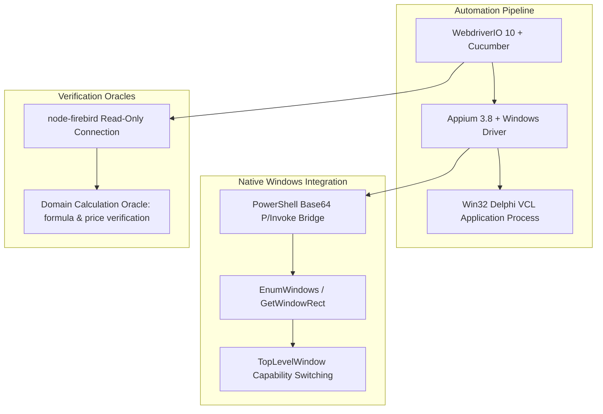

# 🖥️ Windows Desktop Automation Suite — Legacy Win32 & Delphi VCL

[](https://appium.io/)
[](https://github.com/appium/appium-windows-driver)
[](https://webdriver.io/)
[](https://cucumber.io/)
[](#-ai-agent-governance-and-tooling)

> 🌐 **Language Note:** While this documentation is written in English for international review, the entire codebase, Gherkin features (`# language: pt`), step definitions, and `.agents/` context files are authored in **Brazilian Portuguese (pt-BR)**.

---

## 📌 Project Overview

This repository demonstrates an advanced, enterprise-grade test automation framework for a **legacy Win32/Delphi (VCL) desktop application**, utilizing **Appium 3.x** with the official **Windows Driver 6.3** (the modern successor to WinAppDriver), **WebdriverIO 10**, and **Cucumber (BDD)**.

Automating legacy Win32/Delphi applications presents unique challenges that standard web or modern desktop frameworks do not face:
* **Unstable Automation IDs:** Delphi VCL controls (`TJPsEdit`, `TBitBtn`, `TPanel`) lack native `AutomationProperties.AutomationId` accessibility attributes. Handles change across every execution run.
* **Separated Top-Level Windows:** Modal windows, login dialogs, and main windows spawn as distinct Win32 top-level windows rather than accessible child nodes, requiring dynamic window handle enumeration.
* **Database Session Locking:** Hard-killing desktop processes under test triggers Firebird database connection locks on subsequent launches.

This framework solves these challenges through custom Win32 native bridges, coordinate-based physical clicking, settle pauses, and deep domain calculation oracles.

---

## 🏗️ Architecture and Engineering Patterns



### Key Technical Achievements:
1. **Dynamic Top-Level Window Attachments (`tests/support/windowsNative.js`):**
   Uses native Win32 P/Invoke functions executed through PowerShell and streamed via Base64 (preventing console codepage mojibake) to identify window handles (`HWND`) and seamlessly switch the Appium session via `appium:appTopLevelWindow`.
2. **Delphi Control Locator Strategy:**
   Eliminates slow, repetitive XPath tree crawls (which cost 6-20s per check in large VCL windows). Employs physical OS-level clicks on bounding rectangles combined with `windows: keys` typing and stable `Name` properties.
3. **Cascading Warning & Dialog Handlers:**
   Implements an automated polling loop capable of detecting, prioritizing, and dismissing conditional warning popups (e.g., *"User already connected to database"*), allowing tests to proceed uninterrupted.
4. **Domain Calculation Verification Oracle:**
   Directly connects to a Firebird 2.5 database in read-only mode to extract underlying raw batch and laudo parameters, feeding an independent verification oracle (`tests/support/calculo/modelo.js`) that verifies the exact financial and pharmaceutical values displayed on screen.

---

## 🧪 Feature Inventory

| Feature Suite | Scope | Target Screen / Module |
| :--- | :--- | :--- |
| `0.os.feature` | Work Order Management | Service Orders, Status, Field notes |
| `1.login.feature` | Desktop Authentication | Login dialog, invalid credentials, virtual keyboard |
| `2.receitas.feature` | Prescription Management | Formula entry, delivery, payment method popups |
| `3.estoque.feature` | Inventory & Batch Control | Batch replenishment, conference, NF-e import |
| `4.calculo.feature` | Mathematical Domain Engine | Multi-item formula price, excipients, technical tax calculations |

---

## 🚀 Getting Started

### Prerequisites
* **OS:** Windows 10 or Windows 11
* **Node.js:** v20.x or v24.x
* **Appium 3.x:** With Windows driver installed:
  ```bash
  npm install -g appium
  appium driver install windows
  ```
* **Developer Mode:** Enabled in Windows Settings

### Installation
```bash
git clone https://github.com/Kal9941/desktop-appium-delphi-suite.git
cd desktop-appium-delphi-suite
npm install
```

### Configuration (`env.json`)
```json
{
  "app": {
    "executablePath": "C:\\Program Files\\SampleERP\\app.exe",
    "processName": "app.exe"
  },
  "banco": {
    "host": "localhost",
    "port": 3050,
    "database": "C:\\Database\\app.fdb"
  }
}
```

### Running Tests
```bash
# Run all features
npm test

# Run a specific feature
npx wdio run wdio.conf.js --spec tests/features/1.login.feature
```

---

## 🤖 AI Agent Governance (`.agents/`)

Maintains complete persistent context memory for AI assistants:
* `AGENTS.md`: Low-level Win32 heuristics, timing rules, and strict single-session checkpoints.
* `PROJECT_CONTEXT.md`: Complete screen catalog and inventory of Delphi class names (`Tf<MODULE>_<N>`).
* `ROADMAP.md`: Backlog and performance optimization checkpoints.

---

## 👤 Author
**Klismam Monteiro**
* GitHub: [@Kal9941](https://github.com/Kal9941)
* Email: [klismammonteiro1994@outlook.com](mailto:klismammonteiro1994@outlook.com)
